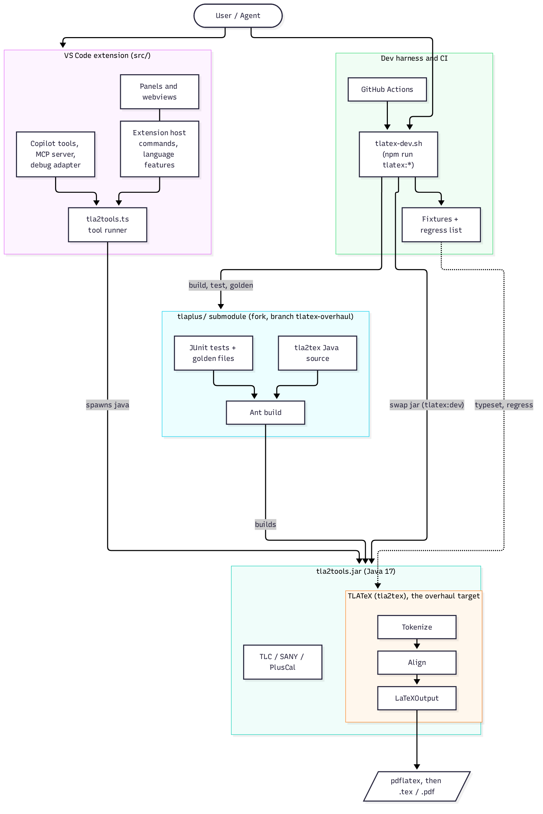

# Architecture overview

High-level view of the system: the VS Code extension (workspace and harness), the
`tlaplus/` submodule that holds the TLATeX source we are overhauling, and the
dev/test/CI tooling around it. See [TLATEX_DEV.md](TLATEX_DEV.md) for the workflow.



The diagram source is [images/architecture.mmd](images/architecture.mmd). To regenerate the PNG after editing it:

```sh
npx -p @mermaid-js/mermaid-cli mmdc -i docs/images/architecture.mmd -o docs/images/architecture.png -b white -s 2
```

## Components

| Component | Role | Location |
| --- | --- | --- |
| Extension host | Activates the extension, registers commands and language providers | `src/main.ts`, `src/commands/`, `src/completions/`, `src/symbols/`, `src/formatters/` |
| Tool runner | Builds Java options and spawns `tla2tools.jar` (TLC, SANY, PlusCal, TLATeX) | `src/tla2tools.ts` |
| UI and AI integration | Webview panels, Copilot language-model tools, MCP server, debug adapter | `src/panels/`, `src/webview/`, `src/lm/`, `src/debugger/` |
| `tla2tools.jar` | Bundled Java toolchain. `tlatex:dev` swaps in a local build; never committed | `tools/` |
| TLATeX pipeline | Tokenize, align, emit LaTeX, run `pdflatex` | `tlaplus/tlatools/org.lamport.tlatools/src/tla2tex/` |
| Submodule tests | JUnit tests and golden `.tex` files for TLATeX | `tlaplus/.../test/tla2tex/`, `test-model/tla2tex/` |
| Dev harness | One entry point for doctor, setup, test, golden, regress, dev, check | `scripts/tlatex-dev.sh` |
| Fixtures | Sample specs for new syntax; regression list | `tests/fixtures/tlatex/`, `tests/tlatex-regress.txt` |
| Guards | Block jar, Eclipse metadata, and unpushed submodule pointer commits | `.githooks/` |
| CI | Extension CI, TLATeX Java CI, release | `.github/workflows/` |
| Recon repo | Second git dir tracking `tla2tex/`, fixtures, docs, scripts, deliverables | `scripts/recon.sh` |
